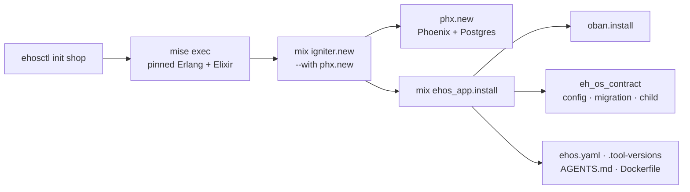

# ehos-tools

Create an application that runs on [EHOS](https://github.com/empoweredhouse/eh-os) with one command,
and keep it current as EHOS grows.

```sh
ehosctl init shop
```

> **Status: an early working version, ahead of the EHOS roadmap on purpose.** `ehosctl init` works
> end to end on macOS arm64, from the binary to a project that passes its own checks against a real
> database. The Homebrew tap is not published yet, EHOS does not read `ehos.yaml` yet, and the Docker
> image of a generated project does not build yet. What is guessed and what is open is recorded in
> [docs/spike.md](docs/spike.md).

## What this is

EHOS is a governed platform for applications a company owns. It checks that deployed software still
does what the business agreed it should do. An application takes part in that by declaring its
business process as a contract ([`eh_os_contract`](https://github.com/empoweredhouse/eh-os-contract)),
by stating what it needs from the platform in `ehos.yaml`, and by being built and delivered the way
EHOS expects.

Wiring all of that into a new project by hand is a day of work, and it is easy to get subtly wrong.
Two examples: the contract engine has to start after the repo and Oban, and its migration has to run
after Oban's. This repository does it in one command:

- **`ehosctl`** is the command-line tool for EHOS. Its first command, `init`, creates an
  application. Later commands (`login`, `verify`, calling a declared command) will go through the
  EHOS API as EHOS defines it.
- **`ehos_app`** is the template. It is an [Igniter](https://hexdocs.pm/igniter/readme.html)
  installer that turns a fresh Phoenix project into an EHOS application. Because it is a dependency
  the application keeps, rather than files copied once, a project generated today can be upgraded
  later.

The template helps, and EHOS enforces. Nothing the template writes is a security boundary: a
developer can change or delete any of it. Whatever matters is checked again by EHOS when the
application is deployed.

## What you get

`ehosctl init shop` creates `shop/`, a Phoenix 1.8 application with PostgreSQL, plus:

```text
shop/
├── .tool-versions                         the Erlang and Elixir everything else was built with
├── ehos.yaml                              what the application needs from EHOS, never how
├── AGENTS.md                              EHOS rules for coding agents, above Phoenix's own
├── CLAUDE.md                              loads AGENTS.md
├── Dockerfile, rel/                       a release, from `mix phx.gen.release --docker`
├── lib/shop/application.ex                Repo → Oban → EhOsContract → Endpoint
├── lib/shop/contracts/case_handling.ex    an example contract to replace
├── priv/repo/migrations/                  Oban's tables, then the contract engine's
└── mix.exs                                `mix precommit` runs `eh_os_contract.check`
```

It starts with a first commit, the pinned toolchain trusted by mise, and dependencies fetched and
compiled. The next steps are `mix ecto.setup` and `mix precommit`.

## Getting started

You need [mise](https://mise.jdx.dev) and a PostgreSQL. You do not need Erlang or Elixir installed:
`ehosctl` carries its own runtime, and the project's runtime is mise's to install.

Once the tap is published, installing will be one command. The formula depends on mise, so it also
installs mise:

```sh
brew install empoweredhouse/tap/ehosctl
```

Until then, build the binary from source. See [packages/ehosctl](packages/ehosctl/README.md#building-the-binary).

## How it works



Each `ehosctl` release pins one template, in
[`template.ex`](packages/ehosctl/lib/ehosctl/template.ex):

- the Erlang and Elixir versions;
- the `phx_new` and `igniter_new` archives;
- the `ehos_app` version.

This is how `phx_new` works as well: a given version of the tool always generates the same project,
whichever machine runs it.

Four rules the design keeps:

- **Standard tools, composed.** Phoenix generates the application and Igniter patches it. Oban
  installs itself through its own installer. Burrito packages the CLI and mise provides the toolchain.
  The code in this repository is only what is specific to EHOS.
- **One toolchain from laptop to image.** The versions `init` runs under are the ones it writes into
  `.tool-versions`, and the ones the generated Dockerfile builds with.
- **Nothing global changes.** The generator's archives live in a directory owned by `ehosctl`, and
  the toolchain in mise's. Your own `~/.mix` and your version manager's defaults are left alone.
- **Idempotent and upgradable.** Running the installer twice changes nothing, and a test pins that.
  Future template changes reach existing projects through `mix igniter.upgrade ehos_app`.

Why this stack and not another is in [docs/research.md](docs/research.md).

## Repository layout

| Path | What |
| --- | --- |
| [`packages/ehosctl/`](packages/ehosctl/README.md) | the CLI, one self-contained binary per platform |
| [`packages/ehos_app/`](packages/ehos_app/README.md) | the template, as `mix ehos_app.install` |
| [`packaging/homebrew/`](packaging/homebrew/ehosctl.rb) | the draft Homebrew formula, for a `homebrew-tap` repository |
| [`docs/research.md`](docs/research.md) | the options considered for building, installing and pinning, and the choice for each |
| [`docs/spike.md`](docs/spike.md) | what was built and measured, and what is still open |

Each package is its own Mix project, with its own version and changelog
([ehosctl](packages/ehosctl/CHANGELOG.md), [ehos_app](packages/ehos_app/CHANGELOG.md)), because
they are released separately. A new `ehos_app` does not need a new `ehosctl`, only a new pin in it.

## Development

```sh
cd packages/ehos_app && mix check
cd packages/ehosctl && mix check
```

`mix check` is the gate: formatting, compilation with warnings as errors, and the tests. How code,
tests and commits are expected to look is in [CONTRIBUTING.md](CONTRIBUTING.md).

## Related projects

- [EHOS](https://github.com/empoweredhouse/eh-os) is the platform, and holds the specification. Its
  [roadmap](https://github.com/empoweredhouse/eh-os/blob/main/docs/ROADMAP.md) plans the application
  template as Stage 6 and `ehosctl` as Stage 7. This repository is an early answer to both.
- [eh-os-contract](https://github.com/empoweredhouse/eh-os-contract) is the contract engine every
  generated application depends on.

## License

No license has been selected yet. Like EHOS itself, the licensing terms are a founder decision.
