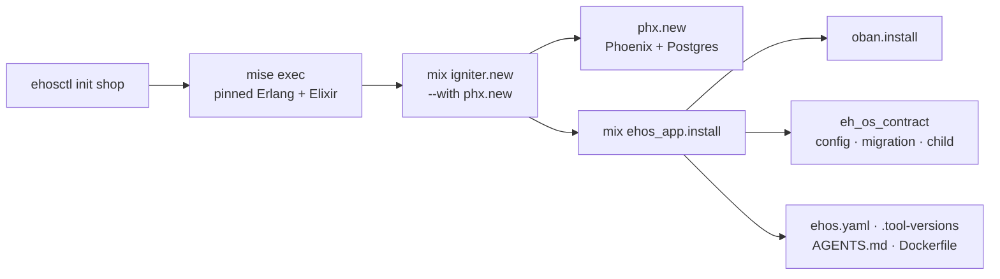

# ehos-tools

Create an application that runs on [EHOS](https://github.com/empoweredhouse/eh-os) with one command,
and keep it current as EHOS grows.

```sh
ehosctl init shop
```

> **Status: an early working version, ahead of the EHOS roadmap on purpose.** `ehosctl init` works
> end to end on macOS and Linux, from the binary to a project that passes its own checks against a
> real database: tested on macOS arm64 and in an Ubuntu 24.04 arm64 container. CI runs the same
> path on all four platforms. The template follows what EHOS decided for its first deployment
> (`ehos.yaml`, health, the variables an application is given), and the Docker image of a
> generated project builds with a GitHub token as a build secret. The first release, 0.1.0, is
> internal while the repository is private: see [Getting started](#getting-started). What is open is
> recorded in [docs/spike.md](docs/spike.md).

## What this is

EHOS is a governed platform for applications a company owns. It checks that deployed software still
does what the business agreed it should do. An application takes part in that by declaring its
business process as a contract ([`eh_os_contract`](https://github.com/empoweredhouse/eh-os-contract)),
by stating what it needs from the platform in `ehos.yaml`, and by being built and delivered the way
EHOS expects.

Wiring all of that into a new project by hand is a day of work, and it is easy to get subtly wrong.
Two examples: the contract engine has to start after the repo and Oban, and its migration has to run
after Oban's. This repository does it in one command:

- **`ehosctl`** is the command-line tool for EHOS. Its first command, `init`, creates an
  application. Later commands (`login`, `verify`, calling a declared command) will go through the
  EHOS API as EHOS defines it.
- **`ehos_app`** is the template. It is an [Igniter](https://hexdocs.pm/igniter/readme.html)
  installer that turns a fresh Phoenix project into an EHOS application. Because it is a dependency
  the application keeps, rather than files copied once, a project generated today can be upgraded
  later.

The template helps, and EHOS enforces. Nothing the template writes is a security boundary: a
developer can change or delete any of it. Whatever matters is checked again by EHOS when the
application is deployed.

## What you get

`ehosctl init shop` creates `shop/`, a Phoenix 1.8 application with PostgreSQL, plus:

```text
shop/
├── .tool-versions                    the Erlang and Elixir everything else was built with
├── ehos.yaml, .ehos/                 what the application needs from EHOS, and EHOS's schema for it
├── AGENTS.md, CLAUDE.md              EHOS's rules for coding agents, and where to read the rest
├── VISION.md                         what EHOS is, where the application sits in it, and its own vision
├── ARCHITECTURE.md, TESTING.md       how the application is built and tested, as the installer knows it
├── README.md                         what the application is built on, and how to start it
├── docs/phoenix.md                   Phoenix's rules for agents, moved out of AGENTS.md as Phoenix wrote them
├── .agents/skills/, .claude/skills/  plan, ship, review, elixir-anti-patterns-review, and their links
├── .coderabbit.yaml, .github/        the AI review's configuration, the pull request template
├── Dockerfile, rel/                  a release, from `mix phx.gen.release --docker`, with a build secret
├── .github/workflows/ci.yml          the gates, then the image by digest beside the manifest
├── lib/shop/application.ex           Repo → Oban → EhOsContract → EhOsContract.Auth → Health → Endpoint
├── lib/shop/domain.ex                the example domain, named as the application is in EHOS
├── lib/shop/contracts/entries.ex     an example contract to replace, beside the rules for writing one (AGENTS.md)
├── lib/shop_web/health.ex            /health/live and /health/ready, on port 4001
├── test/harness_test.exs             keeps the docs honest: links, line budgets, no ADRs, skill links
├── priv/repo/migrations/             Oban's tables, then the contract engine's and the verifier's
└── mix.exs                           `mix precommit` runs `eh_os_contract.check`
```

It starts with a first commit, the pinned toolchain trusted by mise, and dependencies fetched and
compiled. The next steps are `mix ecto.setup` and `mix precommit`. In production it is configured
by the variables EHOS gives an application at start, and nothing else.

## Platforms

| Platform | Status |
| --- | --- |
| macOS, Apple silicon (arm64) | Supported. Tested end to end by hand; CI's end-to-end job runs on `macos-15` |
| macOS, Intel (x64) | Supported. CI's end-to-end job runs on `macos-15-intel`, the last Intel image GitHub offers, which it retires in August 2027 |
| Linux, x64 and arm64 | Supported. Tested end to end in an Ubuntu 24.04 arm64 container; CI's end-to-end jobs run on Ubuntu 24.04, x64 and arm64. Other distributions work, but Erlang may be compiled from source: see [Linux](packages/ehosctl/README.md#linux) |
| Windows | Not supported. [WSL 2](https://learn.microsoft.com/windows/wsl/) with the Linux binary is the route to try; it is not tested. Why, and what support would take: [Windows](packages/ehosctl/README.md#windows) |

`eh-os-contract` is private, so CI's end-to-end jobs read it with a token from a GitHub App that can
read that one repository: see [CONTRIBUTING.md](CONTRIBUTING.md#ci).

## Getting started

You need [mise](https://mise.jdx.dev) and a PostgreSQL. You do not need Erlang or Elixir installed:
`ehosctl` carries its own runtime, and the project's runtime is mise's to install.

Install it with mise, which you need anyway, on macOS and Linux alike:

```sh
mise use -g github:EmpoweredHouse/ehos-tools
```

While the repository is private, mise needs a GitHub token that can read it. It reads one from
`GITHUB_TOKEN` or `MISE_GITHUB_TOKEN`, or from `gh`'s `~/.config/gh/hosts.yml`
(`github.gh_cli_tokens`, on by default). `gh` keeps its token in the system's keyring instead,
unless it was signed in with `--insecure-storage`, and mise does not read the keyring. Without a
token, GitHub answers mise's request for the releases with a 404, as it answers for a repository
that does not exist. Prefer a fine-grained token that reads ehos-tools alone, with *Contents: read* and,
since mise 2026.10 reads the release's attestations with it, *Attestations: read*. Its *Resource
owner* is EmpoweredHouse, not your account, or it cannot see the repository and gets the same 404:

```sh
MISE_GITHUB_TOKEN=<the fine-grained token> mise use -g github:EmpoweredHouse/ehos-tools
```

`MISE_GITHUB_TOKEN=$(gh auth token)` works too, for the one command. That token can usually write
to every repository you can, so do not export it in a shell profile, where every process you start,
a dependency's build script included, would read it. A later `mise upgrade` or `mise install` of
`ehosctl` needs the token again, the same way.

There is no Homebrew tap yet: Homebrew downloads a formula's binary without credentials, so it
cannot install from this private repository's releases. The formula waits in
[`packaging/homebrew/`](packaging/homebrew/ehosctl.rb) until the repository is public
([docs/spike.md](docs/spike.md)).

The binaries are also attached to each [release](https://github.com/empoweredhouse/ehos-tools/releases),
with a `SHA256SUMS` file to check them against. To build the binary from source, see
[packages/ehosctl](packages/ehosctl/README.md#building-the-binary).

## How it works



Each `ehosctl` release pins one template, in
[`template.ex`](packages/ehosctl/lib/ehosctl/template.ex):

- the Erlang and Elixir versions;
- the `phx_new` and `igniter_new` archives;
- the `ehos_app` version.

This is how `phx_new` works as well: a given version of the tool always generates the same project,
whichever machine runs it.

Four rules the design keeps:

- **Standard tools, composed.** Phoenix generates the application and Igniter patches it. Oban
  installs itself through its own installer. Burrito packages the CLI and mise provides the toolchain.
  The code in this repository is only what is specific to EHOS.
- **One toolchain from laptop to image.** The versions `init` runs under are the ones it writes into
  `.tool-versions`, and the ones the generated Dockerfile builds with.
- **Nothing global changes.** The generator's archives live in a directory owned by `ehosctl`, and
  the toolchain in mise's. Your own `~/.mix` and your version manager's defaults are left alone.
- **Idempotent and upgradable.** Running the installer twice changes nothing, and a test pins that.
  A later template reaches an existing project by moving its `ehos_app` dependency and running
  `mix ehos_app.install` again
  ([T-02](docs/adr/0002-a-project-takes-a-later-ehos-app-by-running-the-installer-again.md)).

Why this stack and not another is in [docs/research.md](docs/research.md).

## Repository layout

| Path | What |
| --- | --- |
| [`packages/ehosctl/`](packages/ehosctl/README.md) | the CLI, one self-contained binary per platform |
| [`packages/ehos_app/`](packages/ehos_app/README.md) | the template, as `mix ehos_app.install` |
| [`packages/ehos_design/`](packages/ehos_design/README.md) | the EmpoweredHouse design system's tokens, fonts and a layer for Tailwind and daisyUI: meant as the default look of a generated application |
| [`packaging/homebrew/`](packaging/homebrew/ehosctl.rb) | the draft Homebrew formula, for a `homebrew-tap` repository |
| [`docs/research.md`](docs/research.md) | the options considered for building, installing and pinning, and the choice for each |
| [`docs/spike.md`](docs/spike.md) | what was built and measured, and what is still open |

Each package is its own Mix project, with its own version and changelog
([ehosctl](packages/ehosctl/CHANGELOG.md), [ehos_app](packages/ehos_app/CHANGELOG.md),
[ehos_design](packages/ehos_design/CHANGELOG.md)), because they are released separately. A new `ehos_app` does not need a new `ehosctl`, only a new pin in it.

## Development

```sh
cd packages/ehos_app && mix check
cd packages/ehosctl && mix check
cd packages/ehos_design && mix check
```

`mix check` is the gate: formatting, compilation with warnings as errors, and the tests. CI runs it
for every package, cross-builds the four binaries on Linux and generates a project with each of them
on its own platform ([`.github/workflows/ci.yml`](.github/workflows/ci.yml)). How code, tests and commits are
expected to look, and how a release is made, is in [CONTRIBUTING.md](CONTRIBUTING.md).

## Related projects

- [EHOS](https://github.com/empoweredhouse/eh-os) is the platform, and holds the specification. Its
  [roadmap](https://github.com/empoweredhouse/eh-os/blob/main/docs/ROADMAP.md) plans the application
  template as Stage 6 and `ehosctl` as Stage 7. This repository is an early answer to both.
- [eh-os-contract](https://github.com/empoweredhouse/eh-os-contract) is the contract engine every
  generated application depends on.

## License

No license has been selected yet. Like EHOS itself, the licensing terms are a founder decision.
