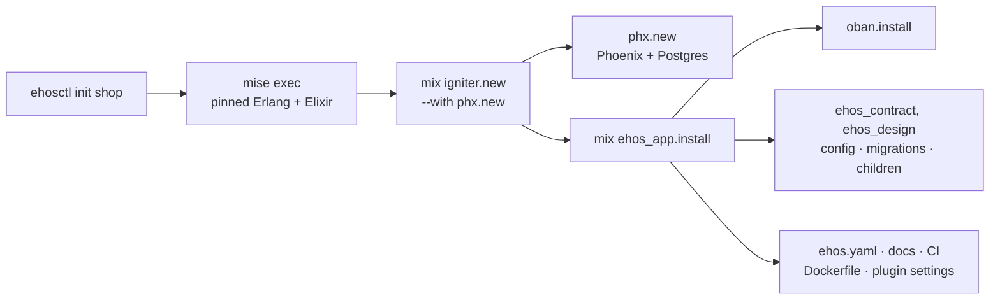

# ehos-tools

[](LICENSE)
[](https://github.com/EmpoweredHouse/ehos-tools/releases/latest)

EHOS is a platform that runs the internal applications of a company, such as billing, approvals
or equipment. An application describes each business process as a contract: the commands that
people can give, and the events that follow. A capability is the right to give one command. EHOS
deploys the application, and controls which person has each capability. EmpoweredHouse builds
EHOS. The specification of EHOS is in the [eh-os](https://github.com/empoweredhouse/eh-os)
repository, which is private for now.

This repository holds the tools to build, run and govern applications on EHOS:

- `ehosctl`, the command-line tool;
- `ehos_app`, the template that `ehosctl` creates applications from;
- `ehos_design`, the design system that gives those applications their look;
- the code that installs EHOS itself.

```sh
ehosctl init shop      # a new application, ready for EHOS
ehosctl verify         # check it as CI does, and have EHOS check what it declares
ehosctl deploy shop --env shop-try --image … --manifest …   # a candidate, then promoted
ehosctl call shop shop.record_entry amount:=100
```

> **Status: in use, early.** `ehosctl` creates, checks, deploys and calls applications, makes the
> server under an installation, and installs and upgrades EHOS on it; applications in production
> use were generated from the template and run on EHOS. Releases are internal while the
> repository is private: see
> [While the repository is private](packages/ehosctl/README.md#while-the-repository-is-private).
> What is still open is in [docs/spike.md](docs/spike.md).

## What is in it

Each package is its own Mix project, with its own README and changelog; each released one has its
own version and tags. Nothing at the root is a Mix project.

| Part | What it is | Released as |
| --- | --- | --- |
| [`packages/ehosctl`](packages/ehosctl/README.md) | The command-line tool for EHOS, for a developer and an operator alike: creates an application, checks and deploys it, calls it, manages environments, people and roles, and makes the server an installation runs on. One self-contained binary per platform; each command has a page in [`docs/commands/`](packages/ehosctl/docs/commands) | `vX.Y.Z`, installed with mise |
| [`packages/ehos_app`](packages/ehos_app/README.md) | The application template: an [Igniter](https://hexdocs.pm/igniter/readme.html) installer that turns a fresh Phoenix project into an EHOS application, and that an application keeps as a dependency, so a later template reaches it by running the installer again | `ehos_app-vX.Y.Z` |
| [`packages/ehos_design`](packages/ehos_design/README.md) | The EmpoweredHouse design system: tokens, fonts and component styles for Tailwind and daisyUI, LiveView components, and the layout of a mailed message. The default look of a generated application, and of EHOS's console | `ehos_design-vX.Y.Z` |
| [`packages/ehos_diagrams`](packages/ehos_diagrams/README.md) | The generator of the diagrams in EHOS's documentation: it checks a source laid out by hand in SVG against a repository's vocabulary, and writes it in `ehos_design`'s colours and fonts, light and dark | `ehos_diagrams-vX.Y.Z` |
| [`packages/ehos_platform`](packages/ehos_platform/README.md) | The code that makes the server under an installation with OpenTofu and installs EHOS on it, shared by `ehosctl`'s platform commands and eh-os's own tooling | `ehos_platform-vX.Y.Z` |
| [`packages/ehos_tunnel`](packages/ehos_tunnel/README.md) | The wire of the data tunnel through which a person's database session reaches an application's database: the session's key, its certificate, the protocol, and a client that carries a local port's connections to EHOS's data gateway. Shared by the gateway, eh-os's tests and `ehosctl` | `ehos_tunnel-vX.Y.Z` |
| [`packages/review`](packages/review/README.md) | The review gate for this repository's own pull requests, and CI's check that released changelog sections stay as they were | Never released |
| [`plugins/ehos-app`](plugins/ehos-app/skills) | The Claude Code plugin every generated application enables: skills that plan a change, ship it, and review it through the application's contracts | `ehos-app-vX.Y.Z` |
| [`plugins/ehos-dev`](plugins/ehos-dev/skills) | The Claude Code plugin eh-os, ehos-tools and ehos_contract share: releasing, running a piece of work through an issue, reviewing before a pull request, writing a decision record, keeping eh-os's architecture current, writing Elixir and its tests, writing what a person reads in the docs and the console, drawing a diagram for the docs | `ehos-dev-vX.Y.Z` |
| [`packaging/homebrew`](packaging/homebrew/ehosctl.rb) | The draft Homebrew formula, for a tap once the repository is public | Not yet |
| [`docs/`](docs) | Why the stack is what it is, what was measured and what is still open, the way from an empty machine to an application in use, and the decisions since: see [Where the work is recorded](#where-the-work-is-recorded) | |

The two plugins are published from this repository's marketplace,
[`.claude-plugin/marketplace.json`](.claude-plugin/marketplace.json), which also lists
[`diagram-design`](https://github.com/cathrynlavery/diagram-design) at one commit, for
`ehos-dev:diagrams`; applications take `ehos-app`
from a marketplace of its own name
([T-16](docs/adr/0016-applications-take-the-ehos-app-plugin-from-a-marketplace-of-its-own-name.md)).

## Getting started

You need [mise](https://mise.jdx.dev) and Docker, which runs the project's PostgreSQL. You do not
need Erlang or Elixir: `ehosctl` carries its own runtime, and mise installs the project's.

```sh
mise use -g github:EmpoweredHouse/ehos-tools   # while the repository is private: see Installing
ehosctl init shop
cd shop
mix setup
mix precommit
```

`init` takes about a minute and a half. It generates the project under the Erlang and Elixir it
pins, makes the first commit, and ends with the next steps. What the project holds is in
[`ehos_app`'s README](packages/ehos_app/README.md#what-a-generated-application-gets). The whole way
from here to the application deployed on EHOS and in use is [the golden path](docs/golden-path.md),
command by command; after the first deployment, the generated `DEVELOPMENT.md` is the guide.
To sign in to the application on your own computer, [try it on a local EHOS](docs/local-ehos.md).

### Installing `ehosctl`

```sh
mise use -g github:EmpoweredHouse/ehos-tools
```

`ehosctl` runs on macOS and Linux, on arm64 and x64; Windows is not supported
([why](packages/ehosctl/README.md#windows)). The binaries are
also attached to each [release](https://github.com/empoweredhouse/ehos-tools/releases), with a
`SHA256SUMS` file to check them against. [`ehosctl`'s README](packages/ehosctl/README.md#installing)
has the rest: the token mise needs
[while the repository is private](packages/ehosctl/README.md#while-the-repository-is-private),
[upgrading](packages/ehosctl/README.md#upgrading), [asdf](packages/ehosctl/README.md#with-asdf),
each platform's status, and building the binary from source.

## The generated project's CI

A generated application's CI reads `ehos_contract` and `ehos_design` from private repositories,
through the GitHub App *ehos-tools CI*, installed on ehos_contract and ehos-tools with read access
to their contents and attestations. Until a new repository has the App's ID and private key as the
secrets `EHOS_CI_APP_ID` and `EHOS_CI_APP_PRIVATE_KEY`, its first job fails at once and says so. The
ID and key are EmpoweredHouse's, from an organisation owner:

```sh
gh secret set EHOS_CI_APP_ID --body <the App's ID>
gh secret set EHOS_CI_APP_PRIVATE_KEY < <the App's private key>.pem
```

What the workflow does with them, on `main` and for a pull request, is in
[`ehos_app`'s README](packages/ehos_app/README.md#the-applications-ci).

## How it works



Each `ehosctl` release pins one template, in
[`template.ex`](packages/ehosctl/lib/ehosctl/template.ex): the Erlang and Elixir versions, the
`phx_new` and `igniter_new` archives, and the `ehos_app` version. A given version of the tool
always generates the same project, whichever machine runs it, as `phx_new` does.

Four rules the design keeps:

- **Standard tools, composed.** Phoenix generates the application and Igniter patches it. Oban
  installs itself through its own installer. Burrito packages the CLI and mise provides the
  toolchain. The code in this repository is only what is specific to EHOS.
- **One toolchain from laptop to image.** The versions `init` runs under are the ones it writes into
  `.tool-versions`, and the ones the generated Dockerfile builds with.
- **Nothing global changes.** The generator's archives live in a directory owned by `ehosctl`, and
  the toolchain in mise's. Your own `~/.mix` and your version manager's defaults are left alone.
- **Idempotent and upgradable.** Running the installer twice changes nothing, and a test pins that.
  A later template reaches an existing project by moving its `ehos_app` dependency and running
  `mix ehos_app.install` again
  ([T-02](docs/adr/0002-a-project-takes-a-later-ehos-app-by-running-the-installer-again.md)).

Where these packages sit in EHOS as a whole is in EHOS's
[architecture](https://github.com/EmpoweredHouse/eh-os/blob/main/docs/ARCHITECTURE.md).

## Where the work is recorded

ehos-tools has no roadmap of its own: its work is planned in EHOS's stages, in eh-os's
[ROADMAP.md](https://github.com/EmpoweredHouse/eh-os/blob/main/docs/ROADMAP.md) and the stage plans
beside it. Here:

- [GitHub issues](https://github.com/EmpoweredHouse/ehos-tools/issues) hold this repository's part
  of a step, and the follow-ups a review left;
- [`docs/adr/`](docs/adr/README.md) holds the decisions about how ehos-tools is built, numbered
  `T-xx`; decisions about EHOS itself are eh-os's `D-xx`;
- [`docs/research.md`](docs/research.md) is why the stack is Burrito, Igniter, mise and a Homebrew
  tap, and [`docs/spike.md`](docs/spike.md) what was built and measured, and what is still open;
- each package's `CHANGELOG.md` is what changed for its user, version by version.

Which question each place answers, and when it changes:
[CONTRIBUTING.md, "Where the work is recorded"](CONTRIBUTING.md#where-the-work-is-recorded).

## Contributing

```sh
cd packages/<package> && mix check
```

`mix check` is each package's gate, and CI runs it for every package a pull request touches.
[CONTRIBUTING.md](CONTRIBUTING.md) says how code, tests, commits, pull requests and releases are
expected to look, for people and agents alike; coding agents start at [AGENTS.md](AGENTS.md). Every
pull request of a maintainer is reviewed by its author before it is opened, and records that
review ([`packages/review`](packages/review/README.md)).

You do not need Claude Code to contribute. The maintainers use it, and the review gate in
`.claude/settings.json` applies only inside Claude Code. For a pull request from outside:

1. Run `mix check` in each package that you changed.
2. If your change is visible to a user of a package, add a line under `## [Unreleased]` in its
   `CHANGELOG.md`. Otherwise, write `No changelog: <why>` in the description.
3. Fill in each section of the pull request template.
4. In the section `## Review`, write what you checked. CI fails the pull request while this
   section is empty.

The check of `ehos_app` in CI reads a private repository, and a pull request from a fork gets no
access to it. If your change touches `packages/ehos_app`, that check fails, and a maintainer runs
it for you.

Each person who takes part follows the [code of conduct](CODE_OF_CONDUCT.md). To ask a question
or report a bug, see [SUPPORT.md](SUPPORT.md). To report a security problem, see
[SECURITY.md](SECURITY.md). Do not open a public issue for it.

## Related projects

- [EHOS](https://github.com/empoweredhouse/eh-os) is the platform, and holds the specification:
  what an application must be, `ehos.yaml`, and the API `ehosctl` speaks.
- [ehos_contract](https://github.com/empoweredhouse/ehos_contract) is the contract engine every
  generated application depends on.

## License

ehos-tools is licensed under the [Apache License 2.0](LICENSE), as ehos_contract is. Two parts
keep the terms they came with: the fonts in `packages/ehos_design` are under the SIL Open Font
License 1.1, whose texts are beside them, and the two `elixir-anti-patterns-review` skills, of
`ehos-app` and `ehos-dev`, keep their own Apache-2.0 license and the Elixir Team's notices. An
application `ehosctl init` generates gets a `LICENSE` of its own, Apache-2.0, which is the
application's to change.
